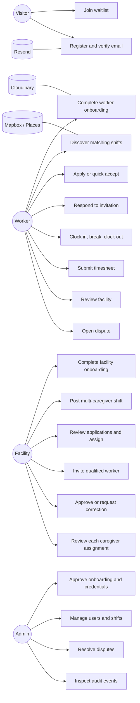
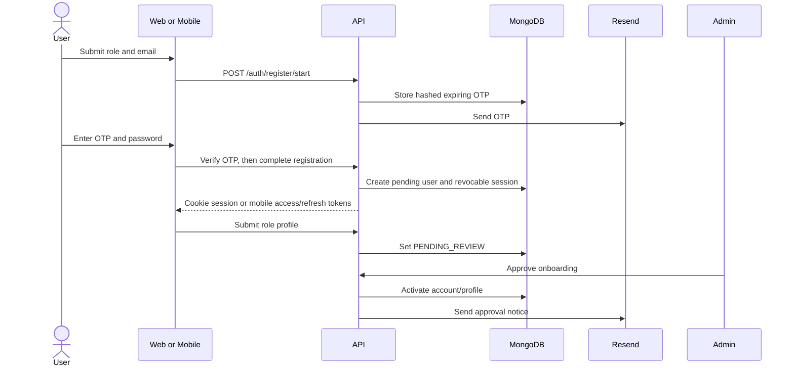
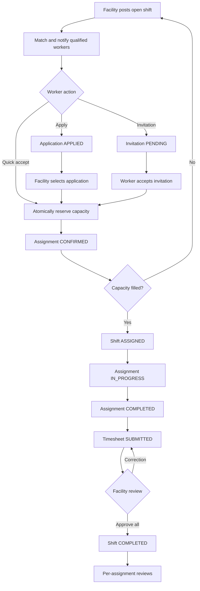
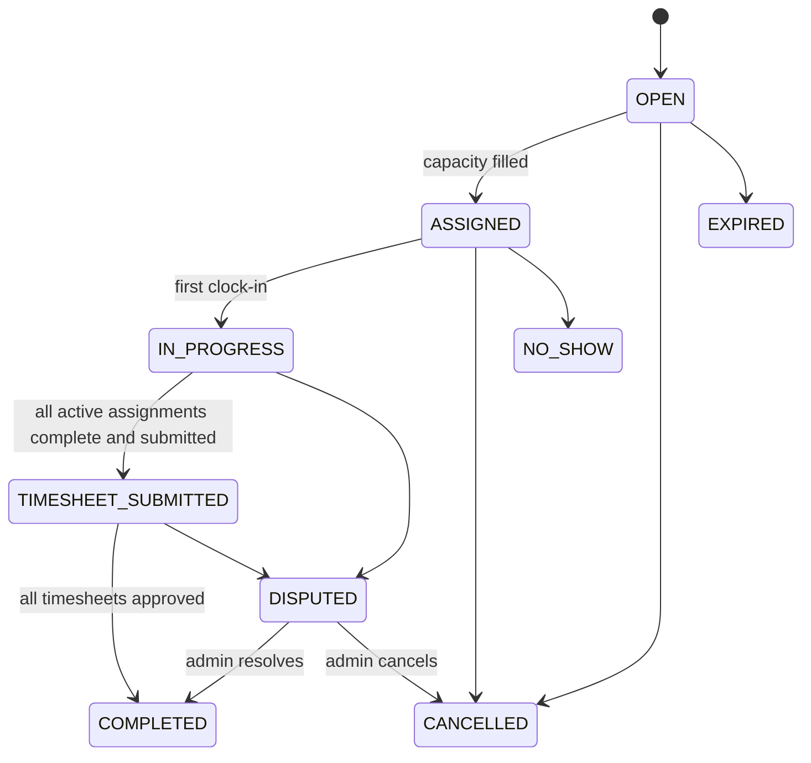
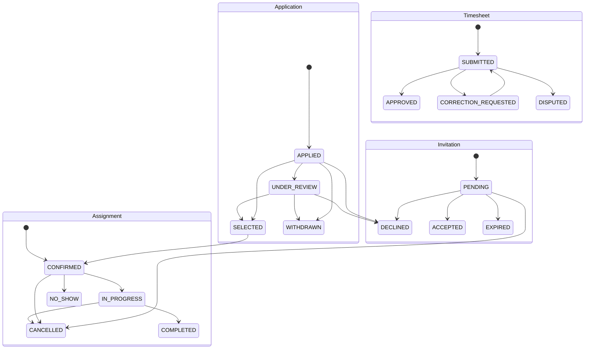
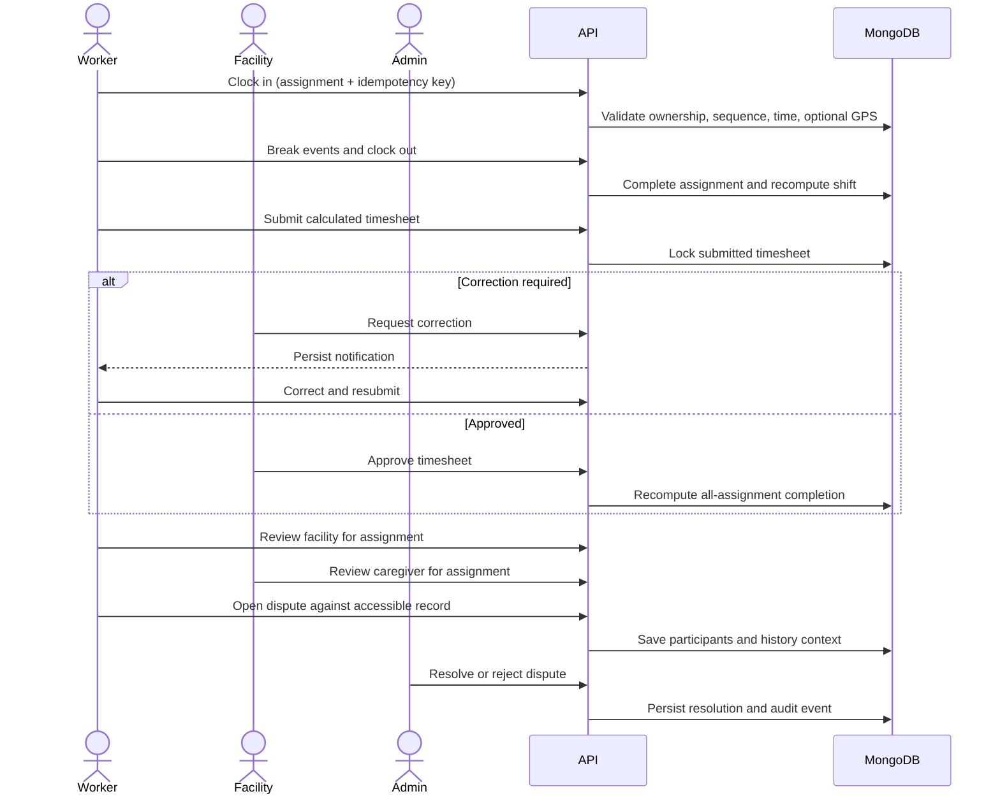
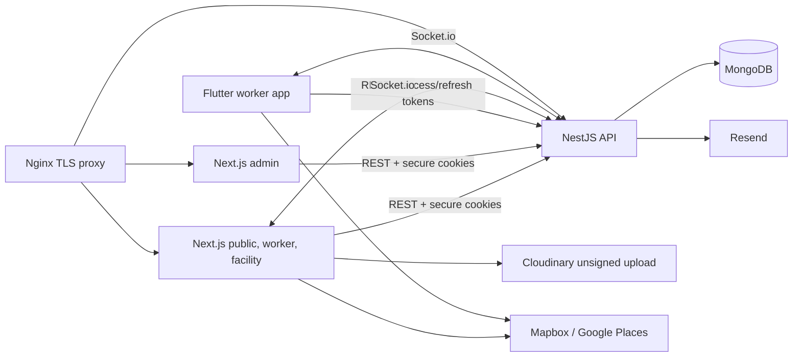
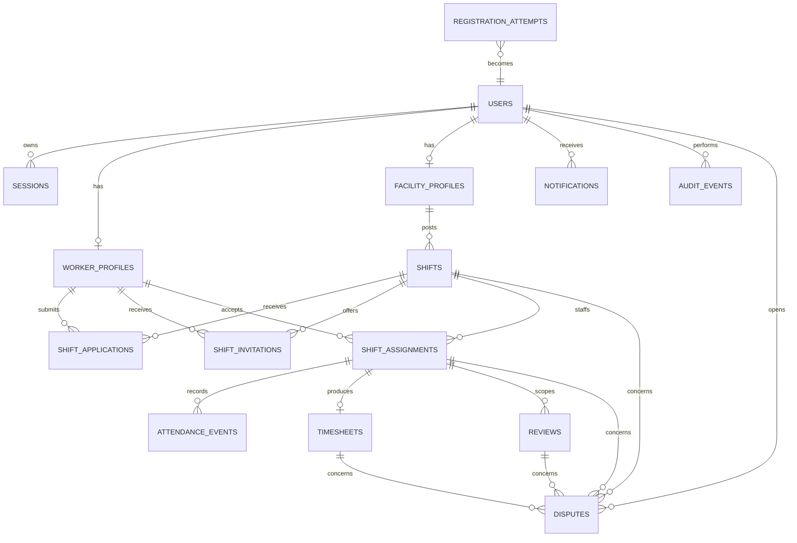

# MedShift Launch MVP Review And Traceability

## Decision Record

The launch MVP includes authentication, role onboarding and approval, shift discovery and posting, applications, invitations, quick acceptance, multi-caregiver assignments, attendance, timesheets, disputes, reviews, persisted notifications, realtime refresh, and admin operations. Payments/payout processing, background push notifications, direct messaging, and horizontally scaled Redis realtime are deferred. Earnings shown in clients are estimates from approved timesheets.

## Gap Register

| Severity | Gap | Actors | Evidence | Remediation | Status |
| --- | --- | --- | --- | --- | --- |
| Critical | Browser bearer tokens survived suspension/password changes | All authenticated users | Browser auth previously persisted JWTs; guards trusted token claims alone | Persisted rotating sessions, active-user checks, cookie/origin-CSRF path, mobile refresh rotation | Implemented; Mongo journey pending CI evidence |
| Critical | Legacy quick accept bypassed assignments and multi-caregiver capacity | Worker, facility | `/shifts/:id/accept` wrote `matchedWorkerId` directly | Quick accept now calls the canonical assignment service | Implemented; Mongo journey pending CI evidence |
| Critical | Concurrent staffing could overfill a shift | Worker, facility | Capacity was calculated with a non-atomic count | Atomic `activeAssignmentCount` reservation, transaction path, safe standalone fallback, unique worker/shift assignment | Implemented; concurrent CI journey added |
| High | Workers could request other workers' application/invitation lists | Worker | Shift-level lists had no worker ownership filter | Role-scoped queries restrict records to the authenticated worker | Implemented |
| High | Attendance idempotency keys could overwrite another event | Worker, facility | Upsert semantics allowed identity fields to change | Immutable key ownership plus event identity, sequence, and timestamp validation | Implemented |
| High | Reviews assumed one `matchedWorkerId` | Worker, facility | Review target resolved from the legacy shift field | Reviews link to assignments with per-assignment uniqueness | Implemented |
| High | Disputes could be created without an owned marketplace record | Worker, facility, admin | Subject IDs and participant access were not resolved consistently | Subject resolution, participant capture, and admin-only resolution | Implemented |
| High | Canonical database documentation omitted marketplace data | Engineering, operations | Architecture/database docs omitted sessions and marketplace collections | Full ER model, collection documentation, and indexes | Complete |
| Medium | Mobile registration used the wrong completion-token field | Worker | Flutter sent `completionToken`; API expects `registrationToken` | Client/API contract aligned and rotating refresh retry added | Implemented; Flutter gates pass |
| Medium | Health check did not verify MongoDB | Operations | `/health` returned static process state | Database ping plus container health dependencies | Implemented; Compose config passes |
| Medium | Existing smoke tests inspected source strings | Engineering | `uat-smoke.mjs` remains a structural compatibility gate | Mongo-backed runtime journey added; Playwright and completed manual UAT remain required | Partial |

## Use Cases

## Authentication And Onboarding Flow

## Staffing Flow

## Lifecycle States

## Attendance, Timesheet, Dispute, And Review Sequence

## Current Component Architecture

## Database ER Diagram

## Feature Traceability

| Use case | API | Client surfaces | Collections | Realtime/notification | Automated evidence |
| --- | --- | --- | --- | --- | --- |
| Registration/session | `/auth/register/*`, `/auth/login`, `/auth/refresh`, `/auth/logout*` | Web auth, admin auth, Flutter auth | users, sessions, registration_attempts | Registration/onboarding email | `launch-mvp.e2e.mjs`; Flutter auth tests |
| Onboarding approval | `/worker-profiles`, `/facility-profiles`, `/admin/*/onboarding` | Worker/facility setup, admin queue | users, worker_profiles, facility_profiles | Persisted + email review result | Mongo launch journey |
| Shift discovery/posting | `/shifts`, `/matching/*` | Worker shift board, facility shifts, mobile board | shifts, profiles | `shift.created`; match notification | Root regression tests; Mongo launch journey |
| Staffing | applications, invitations, assignments, quick accept | Worker/facility marketplace, mobile | shift_applications, shift_invitations, shift_assignments, shifts | application/invitation/assignment notifications; `shift.accepted` | Concurrent three-worker/two-capacity journey |
| Attendance/timesheet | `/attendance/*`, `/timesheets` | Worker work, facility marketplace, mobile work | attendance_events, timesheets, assignments | Attendance and timesheet notifications | Multi-caregiver completion journey |
| Reviews/disputes | `/reviews`, `/disputes` | Worker/facility/admin workflows | reviews, disputes, assignments | Review availability and dispute notifications | Per-assignment review/dispute journey |
| Notifications/realtime | `/notifications`, authenticated Socket.io | All dashboards, mobile center | notifications, sessions | Authenticated user/facility rooms | Root socket regression tests; Mongo launch journey |

## Deferred Roadmap

- Payment processor, payout ledger, reconciliation, refunds, tax reporting, and settlement webhooks.
- Background mobile push delivery; launch provides persisted notifications and foreground realtime refresh.
- Direct worker/facility messaging and moderation.
- Redis Socket.io adapter and cache layer when the API scales beyond one realtime process.
- Formal privacy, legal, accessibility, and security certification by qualified specialists.
