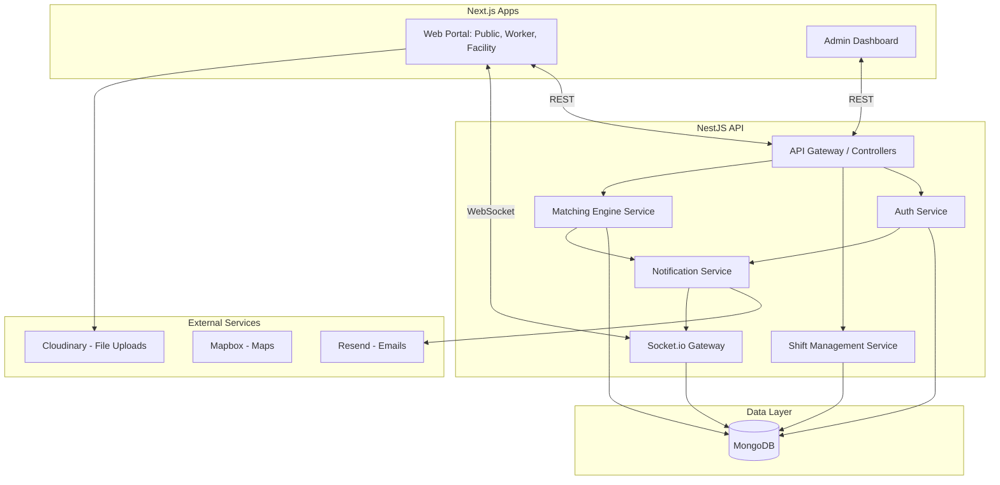

# System Architecture Specification: MedShift

## 1. Overview
MedShift is built as a **Monorepo** to promote code sharing, maintainability, and consistency across the stack. The application consists of Next.js frontends (Public/Facility/Worker portals and Admin dashboard) and a NestJS backend API, powered by a MongoDB database.

The architecture adheres to **SOLID** principles, ensuring that components are modular, decoupled, and easily testable.

## 2. High-Level Architecture Diagram


## 3. Monorepo Structure (Nx / Turborepo)
```
medshift/
├── apps/
│   ├── web/               # Next.js: Public landing, Worker portal, Facility portal
│   ├── admin/             # Next.js: Admin dashboard
│   └── api/               # NestJS: Core backend services
├── packages/
│   ├── shared-types/      # TypeScript interfaces, enums shared across stack
│   ├── ui-components/     # Reusable React components (Design System)
│   └── utils/             # Shared validation, formatting utilities
└── package.json
```

## 4. Backend Architecture (NestJS)
The NestJS application follows a strict modular and layered architecture to enforce SOLID principles.

### Layered Approach
1. **Controllers / Gateways (Interface Layer)**: Handle HTTP requests and WebSocket connections. Route data to services.
2. **Services (Business Logic Layer)**: Contain the core business logic (e.g., Shift Matching). Single Responsibility Principle (SRP) is enforced by keeping services focused (e.g., `ShiftService` handles CRUD, `MatchingService` handles the algorithm).
3. **Repositories (Data Access Layer)**: Abstract Mongoose/MongoDB interactions. Dependency Inversion Principle (DIP) is applied by depending on repository interfaces rather than concrete database implementations.

### Core Modules
- **`AuthModule`**: Handles registration, login, JWT authentication, email verification token creation/validation, verification resend flows, password reset token creation/validation, password updates, and RBAC (Role-Based Access Control) for Workers, Facilities, and Admins.
- **`UserModule`**: Manages user profiles, private verification documents, and background-check statuses.
- **`FacilityModule`**: Manages facility profiles, billing setup, and locations.
- **`ShiftModule`**: Manages shift lifecycle (creation, publishing, completion, cancellation).
- **`MatchingModule`**: Uses geospatial queries (MongoDB `$near`) and worker availability to find matches.
- **`NotificationModule`**: Adapters for Email and campaign contacts (Resend) and Real-time (Socket.io), including registration verification emails, password reset emails, welcome emails, shift notifications, waitlist contact sync, and role-based campaign group sync. Open/Closed Principle (OCP) applies here: new notification channels (e.g., SMS) can be added without modifying existing code.
- **`MarketplaceModule`**: Owns applications, invitations, canonical multi-caregiver assignments, attendance, timesheets, disputes, and marketplace audit events.
- **Session model**: Access JWTs identify a persisted revocable session. Web/admin use HttpOnly cookies plus CSRF protection; mobile uses short-lived access and rotating refresh tokens in secure storage.
- **Two-factor model**: Optional TOTP or email 2FA is stored outside `users`. TOTP secrets use AES-256-GCM encryption; challenges, recovery codes, and trusted-device tokens are hashed or encrypted as appropriate. No session is issued until a login challenge succeeds.
- **Mobile security presentation**: Flutter keeps account-security API orchestration in the settings repository while password, 2FA verification, recovery codes, trusted-device removal, and session revocation are presented through reusable modal bottom-sheet components. This changes presentation only and preserves existing authentication contracts.
- **Notification preferences**: One user-owned preference record controls optional in-app and email delivery by category. Account, verification, onboarding, password, and security alerts are mandatory and bypass optional preferences.

### Authentication Flow
1. **Start Registration**: The API accepts account type and email, requires a work email for facility registrations, stores a hashed six-digit OTP with an expiration timestamp, and asks `NotificationModule` to send the code through Resend. Non-production environments or local environments with `ALLOW_DEV_OTPS=true` use `123456` as the OTP; production generates a random code.
2. **Verify Registration OTP**: The API validates the OTP hash and expiration, marks the registration attempt verified, and returns a short-lived registration completion token.
3. **Complete Registration**: The API validates the completion token, creates the user with password and account type, marks `emailVerified` as `true`, clears the registration attempt, sends a welcome email through `NotificationModule`, and returns a JWT session. The web client stores the session and transitions to a non-form success state with role-specific verification instructions and a profile-completion call to action.
4. **Legacy Email Links**: Existing email verification token handling remains available for pending accounts created before the OTP flow.
5. **Login Gate**: After validating the password, login rejects unverified users without creating a session. It atomically reserves a 60-second resend window, rotates and sends a verification link when allowed, and returns `EMAIL_VERIFICATION_REQUIRED` with `verificationEmailSent` plus an optional `retryAfterSeconds` value.
6. **Resend Verification**: The standalone recovery endpoint uses the same resend cooldown and keeps its response account-enumeration safe. Incorrect login credentials never trigger verification delivery.
7. **Forgot Password**: The API accepts an email address, returns a generic success response, and if the account exists, stores a hashed six-digit reset OTP with an expiration timestamp and asks `NotificationModule` to send the code. Non-production environments or local environments with `ALLOW_DEV_OTPS=true` use `123456` as the reset OTP.
8. **Verify Password Reset OTP**: The API validates the reset OTP hash and expiration before the web client advances from the OTP step to the set-password step.
9. **Reset Password**: The API revalidates the reset OTP hash and expiration, updates the stored password hash, clears reset token fields, and returns a success response without issuing a session automatically.
10. **Feedback Contract**: Auth endpoints return stable machine-readable error codes for expected states such as `EMAIL_VERIFICATION_REQUIRED`, `REGISTRATION_OTP_INVALID`, `PASSWORD_RESET_INVALID`, and `PASSWORD_RESET_EXPIRED`. Web auth surfaces use the shared toast provider for transient results while retaining only structural step instructions and actions inline.
11. **Role-Based Redirect**: After successful login, the web client uses its secure cookie session, checks role-specific onboarding status for worker and facility accounts, and navigates directly to the final destination. Incomplete worker accounts go to `/worker/onboarding`, incomplete facility accounts go to `/facility/onboarding`, approved users go to their role dashboard, and admins go to the configured admin dashboard origin.
12. **Two-Factor Challenge**: After password validation, an account with 2FA returns HTTP 202 with a ten-minute challenge and no tokens. TOTP allows one adjacent 30-second step; email codes allow five attempts and a 60-second resend interval. Successful verification creates the normal session and may create a hashed trusted-device token valid for 30 days.
13. **Security Revocation**: Password change/reset, logout-all, suspension, or administrative deactivation revokes sessions and trusted devices. Changing the password does not disable the configured second factor.

### Onboarding Flow
1. **Onboarding Status**: Worker and facility profile APIs should expose whether the authenticated user has completed the required onboarding fields and whether admin verification is pending, approved, or rejected.
   - Worker clients read `GET /worker-profiles/onboarding-status`.
   - Facility clients read `GET /facility-profiles/onboarding-status`.
   - Both endpoints return `INCOMPLETE` for authenticated users who have not created a profile yet, allowing the frontend to route directly to profile completion instead of treating missing profile data as an error.
2. **Worker Onboarding & Settings**: The worker flow captures identity details, professional role, location/radius, availability preferences, and categorized verification documents before enabling live shift matching. Government ID, professional certification/licence, and background-check documents are required. Authenticated workers can later replace the same documents from `/worker/settings`.
3. **Facility Onboarding**: The facility flow captures organization details, facility type, service address/geolocation, primary contact details, and billing/readiness information before enabling live shift posting.
   - Onboarding clients use standalone full-screen focused setup layouts, not the shared dashboard shell and not a dashboard-style topbar. The pages should keep users in a guided profile-completion context before they enter role dashboards.
   - Worker onboarding clients save immediately to user-scoped device storage and debounce synchronization to `worker_onboarding_drafts`. The draft stores the active step and partial payload without creating or changing a submitted worker profile. Server drafts resume across web/mobile; device drafts remain an offline fallback. Facility onboarding retains its local draft behavior.
   - Explicit step navigation cancels pending debounce work, persists the latest snapshot locally, and serializes server writes so Save and continue cannot be overwritten by an older request. A nullable or empty onboarding-draft response is normalized to no draft on both web and Flutter.
   - Flutter routing observes restored authentication state and preserves protected deep links after secure-token hydration. Worker onboarding fetches canonical profile, status, and server draft concurrently; optional draft/status failures fall back to device/profile data and never block rendering while an initial device draft synchronizes.
   - Existing worker profiles initialize the wizard from submitted data and open on the complete Review step when no unfinished draft exists. The Flutter Profile exposes one status-aware onboarding card for incomplete, rejected, pending, and approved profiles; it resumes saved work or opens Review without duplicating the shared dashboard banner. If onboarding status reports a profile but profile hydration fails, clients show a retry state and block blank submission.
   - Final worker submission uses idempotent `PUT /worker-profiles/me`; the server resolves identity from the authenticated session and creates or updates the one profile protected by the unique `userId` index. Legacy `POST /worker-profiles` delegates to the same save path during rollout, including duplicate-key race recovery. A successful save returns the canonical profile and clears the server/device drafts; failed saves retain them.
   - `PUT /worker-profiles/onboarding-draft` also resolves the associated profile server-side. Any cached client `profileId` value is ignored. Device drafts reconcile document metadata by stable document ID, keep unsynchronized edits locally, and display the API error with an explicit retry action.
   - Location steps render an interactive Mapbox GL map when `NEXT_PUBLIC_MAPBOX_TOKEN` or `NEXT_PUBLIC_MAPBOX_ACCESS_TOKEN` is configured, falling back to a static coordinate grid when a public token is unavailable or the map script fails to load. When `NEXT_PUBLIC_GOOGLE_PLACES_API_KEY` is configured, the same location steps also expose Google Places address search that can prefill coordinates and, for facility service addresses, structured address fields.
   - Worker document uploads use an authenticated API signing endpoint and direct private Cloudinary delivery. The API validates Cloudinary completion signatures, stores canonical asset metadata, and generates five-minute access URLs only for the owning worker or an admin. Clients never accept pasted document URLs.
   - Owner document access resolves private assets from either the worker's onboarding draft or submitted profile, allowing secure previews before first submission.
   - Because the app runs inside a monorepo, the web Next.js config loads browser-safe `NEXT_PUBLIC_*` values from both the repository root env files and `apps/web` env files. App-specific env files override root values, and the dev server must be restarted after env changes.
4. **Access Gates**: Worker shift acceptance and facility shift posting should detect incomplete onboarding and route users to the relevant profile completion flow with inline guidance.
5. **Worker Dashboard Data**: Worker dashboards read open nearby shifts from `GET /matching/open-shifts`, worker-owned matched/in-progress/completed shifts from `GET /shifts/worker/me`, onboarding/profile status from worker profile endpoints, and submitted reviews from `GET /reviews/me`. `GET /matching/open-shifts` accepts `search`, comma-separated `roles`, `facilityTypes`, and `shiftTypes` alongside radius, duration, pay, and sort; legacy singular role/facility parameters remain compatible. Shift periods are derived in the `America/Edmonton` timezone. Flutter loads its canonical profile separately from draft synchronization so an offline draft cannot hide submitted profile data. Earnings widgets are derived from shift rate and duration until dedicated payment records are introduced.
6. **Admin Verification**: Uploaded worker credentials and completed facility registrations enter the admin verification queue; approval unlocks production matching/posting capabilities.
   - Admins can filter the queue by worker credential reviews or facility registration reviews.
   - Approval updates onboarding verification status to `APPROVED`, activates the account, and sends an approval email.
   - Rejection updates onboarding verification status to `REJECTED`, stores the rejected reason, keeps the account pending, and sends an update-required email.

## 5. Frontend Architecture (Next.js)
- **App Router & Server Components**: Leverages React Server Components (RSC) for initial page loads (SEO, performance) and Client Components for interactive pieces (e.g., Real-time shift boards).
- **State Management**: React Query (for server state and caching) and Zustand/Context (for lightweight client state like UI toggles).
- **Component Design**: 
  - Dumb/Presentational components in `packages/ui-components`.
  - Smart/Container components in `apps/web/features/*`.
- **Dashboard Shell**: Role dashboards should compose a shared application shell with sidebar navigation, topbar, and main content slots. Shell components should live in the shared UI layer when possible, with role-specific navigation models supplied by the consuming app. Onboarding screens are intentionally separate guided setup layouts and should not use the dashboard shell until the user reaches an approved role dashboard.
- **Action Feedback**: Frontends must expose a shared toast/notification provider that works in Next.js client components. Use it for non-blocking success/error feedback and pair it with inline form messages for auth actions. Native browser `alert()`, `confirm()`, and blocking prompts are not permitted in product workflows.

## 6. Real-Time Infrastructure (Socket.io)
- **Namespaces & Rooms**: Connections are organized by namespaces (e.g., `/shifts`) and rooms (e.g., `facility_123` or `geo_calgary`).
- **Events**:
  - `shift.created`: Broadcasted to qualified workers in the geographical area.
  - `shift.accepted`: Notifies the facility immediately when a worker accepts.
  - `worker.status_update`: Updates worker availability in real-time.

The launch deployment uses a single authenticated Socket.io process. A Redis adapter is explicitly deferred until horizontal API scaling is introduced. See `docs/launch_mvp_review.md` for current flows and traceability.
